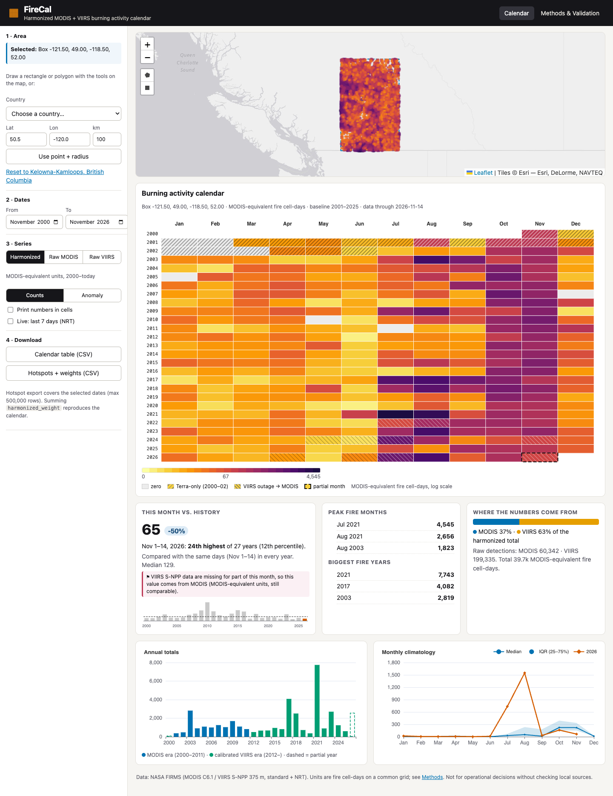

# FireCal: harmonized MODIS + VIIRS burning activity calendar

NASA Space Apps 2026 · "MODIS and VIIRS Hot Spots"

FireCal merges 25 years of satellite active-fire detections from two different sensors into **one consistent series**, then shows it as a **burning activity calendar** (years × months) for any area you choose:

- **MODIS** (Terra + Aqua), 1 km, Nov 2000 → today
- **VIIRS S-NPP**, 375 m, 2012 → today

Raw counts from the two sensors aren't comparable: VIIRS sees about 2–6× more fire. FireCal does three things:
1. counts **fire cell-days** on a common grid instead of raw detections;
2. calibrates VIIRS to **MODIS-equivalent** units per country and month, validated year by year;
3. gives every detection a `harmonized_weight`, so any area can be summed.

See [METHODS.md](METHODS.md) or the app's **Methods & Validation** page. For Canada, leave-one-year-out validation gives monthly R² 0.968, MAPE 18%, bias −2.9%.



## Quick start

```bash
make setup      # python venv (3.11+) + npm install
make dev        # API on :8010, web app on http://localhost:5173
```

Without any downloads, the app serves the **committed sample** (`data/sample/`, 4.5 MB: every cleaned detection in a 3°×3° box around Kelowna–Kamloops, BC, plus Canada's calibration and validation).

### Full data

```bash
cp .env.example .env              # add your FIRMS MAP_KEY (free: firms.modaps.eosdis.nasa.gov/api/map_key)
make data COUNTRIES=Canada        # ~700 MB download, ~1 min processing
make data COUNTRIES=Brazil,Australia,United_States
make sample                       # regenerate data/sample from data/processed
```

When `data/processed/detections` exists, the backend uses it automatically (`DATA_DIR` overrides this).

### Tests

```bash
make test                         # pytest: synthetic end-to-end pipeline + every API endpoint
cd frontend && node e2e/smoke.mjs # Playwright smoke test + screenshots (needs `make dev` running)
```

## Features
- **Area selection:** draw a rectangle or polygon, enter lat/lon + radius, or pick a country. Date range filter. Everything is stored in the URL, so views are shareable.
- **Calendar:** log-scaled inferno counts or a diverging RdBu anomaly view (both colorblind-safe). Tooltips show value, baseline, anomaly, robust z, sensor and detection count. Optional numbers in cells, PNG export, and a table view for screen readers.
- **Flags:** hatched cells mark Terra-only months (2000–02) and VIIRS-outage months filled from MODIS; a dashed border marks the partial current month.
- **Modes:** Harmonized / Raw MODIS / Raw VIIRS. The raw modes show why harmonization is needed.
- **Analytics:** month-to-date vs the same days in every past year (rank, percentile); peak months and years; sensor share; annual totals; climatology (median + IQR, current year overlaid).
- **CSV export:** raw hotspots in the AOI with `cell_id`, `n_det_cellday`, `cellday_weight`, `calibrated_weight` and `harmonized_weight`. Summing `harmonized_weight` reproduces the calendar. The aggregated calendar table is also exportable.
- **Live layer:** last 7 days of NRT detections (NOAA-20/21 + MODIS) from the FIRMS API, cached for 1 hour.

## Layout
```
pipeline/   download.py firms_api.py clean.py grid.py calibrate.py build.py validate.py sample.py config.py
backend/    main.py (FastAPI) queries.py (DuckDB) schemas.py (API contract) firms_client.py
frontend/   React + Vite + TS; src/types.ts mirrors backend/schemas.py
tests/      pytest (synthetic "Testland" dataset runs the real pipeline)
data/       raw/ processed/ (gitignored)   sample/ (committed)
```
API: `GET /api/health · /api/regions · /api/validation · /api/methods · /api/recent?bbox=` and `POST /api/calendar · /api/summary · /api/points · /api/hotspots.csv · /api/calendar.csv` (body: `{aoi: GeoJSON, country, start, end, mode}`). Interactive docs at http://localhost:8010/docs.

Docs: [METHODS](METHODS.md) · [DATA_SOURCES](DATA_SOURCES.md) · [DECISIONS](DECISIONS.md) · [PROGRESS](PROGRESS.md) · [QUESTIONS](QUESTIONS.md) · [HANDOFF](HANDOFF.md)

Data: NASA FIRMS (MODIS Collection 6.1, VIIRS 375 m), Natural Earth boundaries, Esri basemap.
